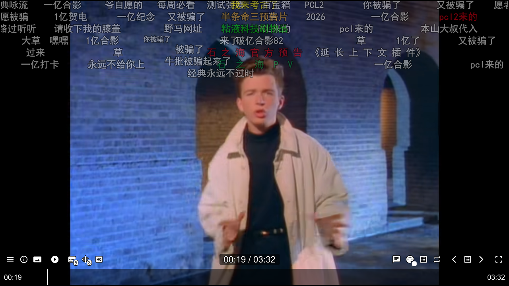
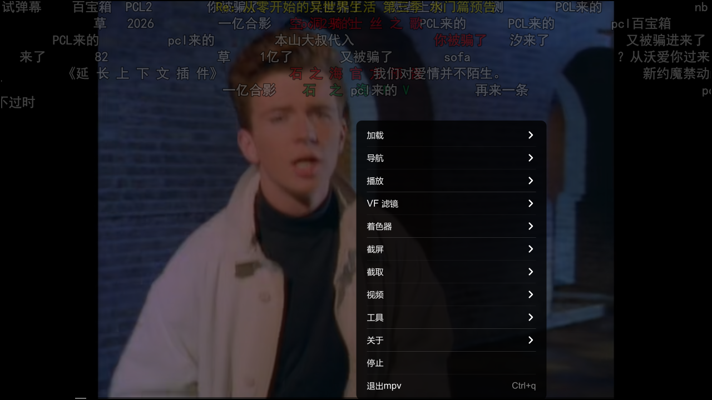
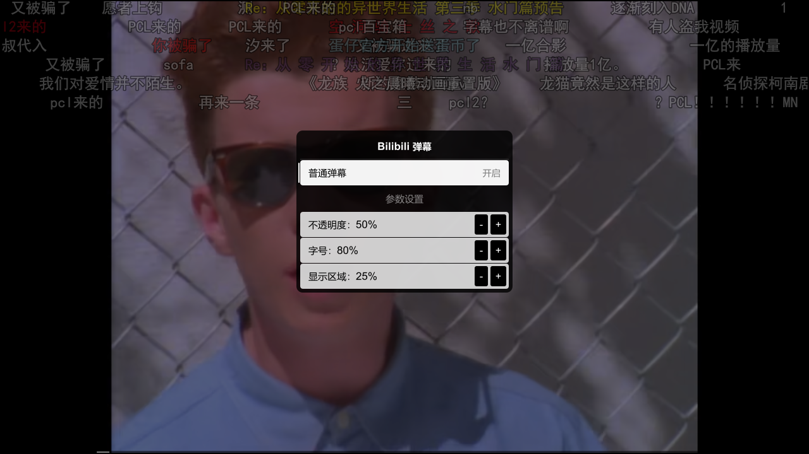

# mpv-rukalazy

> 基于 [hooke007/mpv_PlayKit](https://github.com/hooke007/mpv_PlayKit) 深度定制的 Windows mpv 懒人包。
> 开箱即用，重点增强了 **Bilibili / YouTube 网页播放、实时字幕、弹幕、直播与画面补帧**。

本项目是 [mpv](https://github.com/mpv-player/mpv) 的便携配置集合。把整个文件夹复制到任意盘符、任意目录即可运行，配置、字体、脚本、着色器都跟随目录，不写注册表（除非你主动运行注册脚本）。

**适用环境**：Windows 10 / 11 64 位；补帧、超分与 Whisper CUDA 需要 NVIDIA 显卡。

- **详细安装与配置教程：[docs/使用教程.md](docs/使用教程.md)**
- **下载：请到本仓库的 [Releases](../../releases) 获取完整懒人包（推荐）**

> 仓库只存放文本配置与脚本，不包含 `mpv.exe`、`ffmpeg`、VapourSynth CUDA 运行库、Whisper 模型等大文件。**只克隆仓库是不能直接运行的**，请下载 Releases 里的完整压缩包。

---

## 三步开始

1. **下载解压**：到 [Releases](../../releases) 下载全部分卷，用 7-Zip 解压 `.001` 到可写目录。
2. **安装 ffmpeg**：加入系统 `PATH`（包内不含）。
3. **按需注册**：文件关联双击 `installer\mpv-register.bat`；要 Cookie 桥 / 浏览器投递再运行对应的 `.ps1`。

代理端口不是 `10809` 的，先改 [首次配置 · 代理](#代理重要)，否则联网播放会失败。

---

## 界面预览

B 站视频：弹幕 + uosc 控制栏 + 字幕轨道。



| 右键菜单 | 弹幕设置（`Ctrl+d`） |
| --- | --- |
|  |  |

---

## 功能一览

### 播放与界面

| 功能 | 说明 |
| --- | --- |
| 便携配置 | 全部配置位于 `portable_config/`，换盘、换机器不影响 |
| uosc 界面 | 现代化控制栏，额外集成弹幕、字幕颜色、直播画质等入口 |
| 字幕颜色预设 | uosc 控制栏的字幕颜色按钮，选色后写入 `mpv.conf` 持久保存 |
| 嵌入式歌词 | 自动读取内嵌歌词并显示 |
| 窗口尺寸 OSD | `Ctrl+Shift+方向键` 微调窗口并显示尺寸 |
| 文件关联 | `installer/mpv-register.bat` 一键注册（无需手动改注册表） |
| 测试/纯净/跑分模式 | `installer/` 下的独立 bat，使用不同配置文件启动 |

### Bilibili

| 功能 | 快捷键 | 说明 |
| --- | --- | --- |
| 视频/直播弹幕 | `d` | 自动匹配 cid，支持 CDN 直链与网页地址；再按一次关闭 |
| 弹幕设置 | `Ctrl+d` | 透明度、显示区域、字号，调整后持久保存 |
| 弹幕字号 | `Shift+↑ / Shift+↓` | 每次 ±10% |
| 发送直播弹幕 | `b` | 需登录态（Chrome Cookie 桥） |
| 实时字幕 | `q` | **B 站 AI 字幕优先**，没有 AI 字幕时回退到 Whisper；再按关闭 |
| 实时翻译 | `w` | 仅翻译非中文字幕，不阻塞原字幕 |
| 播放列表 | `Ctrl+v` / `Ctrl+Shift+v` | 当前分 P / 整个合集 |
| 直播画质与线路 | 右键菜单 | 从 uosc 菜单选择当前直播可用的画质/线路 |
| 直播进度同步 | `F5` | 重新对齐直播实时边缘 |
| 刷新当前媒体 | `Ctrl+F5` | 直播断流或换线后重新加载 |
| 收藏/播放列表切换 | `[` / `]` | 上一个 / 下一个文件或收藏 |
| 浏览器「在 mpv 播放」 | [见教程](docs/使用教程.md#4-浏览器在-mpv-播放可选) | 油猴脚本 + 本地桥，把解析出的直链投递到新 mpv 窗口，并自动带弹幕 |

### YouTube 与其他网页视频

- 内置 `yt-dlp.exe`，支持 YouTube、Bilibili 等站点。
- **Chrome Cookie 桥**：由 Chrome 扩展读取登录态 cookies，供会员内容、B 站 AI 字幕等使用；仅本机使用，不上传。
- YouTube Mix/播放列表自动展开。
- 网页媒体的画质/格式可在 uosc 菜单中切换。

### 画面增强（可选，需 NVIDIA）

- VapourSynth + vsmlrt-cuda：**RIFE 补帧**、超分。
- mpv 着色器：Anime4K 等（`portable_config/shaders/`）。
- 导出视频时若启用了补帧等 VS 滤镜，会自动改用 VSPipe 离线渲染，保留效果。

### 截图与片段

| 快捷键 | 功能 |
| --- | --- |
| `Ctrl+s` | 原始画面截图（选择位置/格式） |
| `Ctrl+S` | 渲染截图（带当前滤镜/着色器） |
| `I` / `O` | 标记截取起点 / 导出片段 |
| `Ctrl+Shift+i` / `Ctrl+Shift+o` | 渲染导出起点 / 导出带滤镜的片段 |

---

## 下载与安装

### 1. 下载分卷并解压

完整包约 3.4 GB，受 GitHub 单文件 2 GiB 限制，Release 里拆成了多个分卷（数量以 Release 页面为准）：

```
mpv-rukalazy-v1.0.0.7z.001
mpv-rukalazy-v1.0.0.7z.002
...
```

到 [Releases](../../releases) 把**全部分卷**下载到同一个文件夹，然后：

1. 右键 `.001` → 7-Zip → 「解压到当前文件夹」，目标目录例如 `D:\mpv-rukalazy\`。
2. 其余分卷会被自动读取，**不要**单独解压或改名。
3. 缺任何一个分卷都会报「无法打开压缩包」。

> 需要先装 [7-Zip](https://www.7-zip.org/)（Windows 自带的解压不支持 7z 分卷）。
> 解压到**可写目录**：不要放 `C:\Program Files` 等需要管理员权限的位置，也不要放 OneDrive 等会同步/占位的目录；脚本需要在该目录内写缓存和日志。

### 2. 安装必需依赖：ffmpeg

ffmpeg **不在压缩包内**，请自行安装并加入 `PATH`：

1. 下载 Windows 版 ffmpeg：<https://www.gyan.dev/ffmpeg/builds/>（选 `release-essentials`）。
2. 解压后把 `bin` 目录加入系统环境变量 `PATH`。
3. 命令行执行 `ffmpeg -version` 能输出版本即成功。

用途：Whisper 音频采集、片段导出、VSPipe 渲染等。

### 3. 首次运行

双击 `mpv.exe` 就能播放（拖入视频文件也可以）。第一次启动会自动生成 `portable_config/_cache/` 等运行时目录，属正常现象。

### 4. 注册（建议至少做第 1 项）

mpv 本身是绿色的，不做注册也能播放本地文件。但下面三项会把**当前文件夹的绝对路径**写进注册表，换取系统集成；换目录或复制到别的电脑后必须重跑：

| 脚本 | 作用 | 是否需要管理员 |
| --- | --- | --- |
| `installer\mpv-register.bat` | 文件关联：双击视频/音频默认用 mpv 打开，右键「使用 mpv 播放」。取消用 `installer\mpv-unregister.bat` | 是（会弹 UAC） |
| `portable_config\tools\install_bridge_scheme.ps1` | 注册 `bilibili-mpv://` 协议，浏览器投递按钮才能唤醒 mpv | 否 |
| `portable_config\tools\chrome_cookie_bridge\install_native_host.ps1` | 注册 Chrome 原生消息桥，Cookie 桥扩展才能把 cookies 交给 mpv | 否 |

运行方式：`mpv-register.bat` 直接双击；两个 `.ps1` 在 PowerShell 里执行（路径换成你的解压位置）：

```powershell
powershell -ExecutionPolicy Bypass -File "D:\mpv-rukalazy\portable_config\tools\install_bridge_scheme.ps1"
powershell -ExecutionPolicy Bypass -File "D:\mpv-rukalazy\portable_config\tools\chrome_cookie_bridge\install_native_host.ps1"
```

> 只播放本地视频的话，可以只做第 1 项，或者什么都不做。Cookie 桥、浏览器投递按需再装。

### 5. 可选组件

按需安装，不装也能正常播放本地文件：

| 组件 | 用途 | 安装方式 |
| --- | --- | --- |
| Chrome + Cookie 桥扩展 | B 站 AI 字幕、会员内容、直播弹幕发送 | 见 [教程 · Cookie 桥](docs/使用教程.md#3-chrome-cookie-桥可选但推荐)（Edge 需额外注册） |
| Tampermonkey + 投递脚本 | 在浏览器里点按钮，用 mpv 播放网页视频 | 见 [教程 · 浏览器投递](docs/使用教程.md#4-浏览器在-mpv-播放可选) |
| Node.js 18+ | YouTube PO Token（不装可能影响部分 YouTube 视频） | <https://nodejs.org/>，装完在 `PATH` 中 |
| whisper.cpp CUDA + 模型 | B 站没有 AI 字幕时的实时字幕 | 见 [教程 · Whisper](docs/使用教程.md#5-whisper-实时字幕可选) |
| NVIDIA 显卡驱动 | RIFE 补帧 / 超分 / Whisper CUDA | 官方驱动即可 |

---

## 首次配置要改的地方

### 代理（重要）

`portable_config/mpv.conf` 默认给 yt-dlp 指定了本机代理：

```ini
ytdl-raw-options=proxy=http://127.0.0.1:10809
```

- 用 Clash/V2Ray 等且端口正好是 `10809`：保持不动。
- 端口不同：改成你的端口。
- 不需要代理 / 直连：删除或注释这一行。

否则 YouTube、Bilibili 等联网功能会因连不上代理而失败。

### 其他常用配置

| 文件 | 作用 |
| --- | --- |
| `portable_config/mpv.conf` | 画质、代理、字幕字体、截图路径等主配置 |
| `portable_config/script-opts.conf` | 脚本参数（yt-dlp 路径、弹幕默认值、Whisper 路径） |
| `portable_config/input_uosc.conf` | 快捷键（含本项目新增的 `d/q/w/b/[`/`]` 等） |
| `portable_config/profiles.conf` | 条件配置（按分辨率/帧率自动套用） |
| `portable_config/menu.conf` | 右键菜单项 |
| `portable_config/scripts/uosc/` | uosc 界面及其扩展 |

修改 `mpv.conf`、`script-opts.conf`、`input_uosc.conf` 后需重启 mpv 生效。

---

## 主要快捷键

| 按键 | 功能 |
| --- | --- |
| `q` | 开关实时字幕（B 站 AI 优先 / Whisper） |
| `w` | 开关实时翻译 |
| `d` | 开关弹幕 |
| `Ctrl+d` | 弹幕设置 |
| `Shift+↑/↓` | 弹幕字号 ±10% |
| `b` | 发送直播弹幕 |
| `Ctrl+v` / `Ctrl+Shift+v` | 播放剪贴板链接（当前视频 / 合集全部） |
| `F5` / `Ctrl+F5` | 直播同步 / 刷新媒体 |
| `[` / `]` | 上一个 / 下一个文件或收藏 |
| `v` | 播放列表 |
| `Ctrl+Shift+←/→/↑/↓` | 调整窗口尺寸 |
| `Ctrl+i` | 查看全部按键 |
| 右键 | uosc 菜单（画质、轨道、弹幕等） |

完整按键见 `portable_config/input_uosc.conf`，或在 mpv 里按 `Ctrl+i`。

---

## 目录结构

```
mpv-rukalazy/
├─ mpv.exe / mpv.com / mpv-docs.rst    # 主程序与文档
├─ yt-dlp.exe / deno.exe               # 在线视频解析
├─ python.exe / Lib/                   # 便携 Python（脚本依赖）
├─ portable.vs / vs-plugins/           # VapourSynth 与滤镜插件
├─ portable_config/
│  ├─ mpv.conf / profiles.conf         # 主配置
│  ├─ input_uosc.conf / menu.conf      # 按键与菜单
│  ├─ script-opts.conf                 # 脚本参数
│  ├─ fonts/  shaders/  vs/            # 字体、着色器、VS 脚本
│  ├─ scripts/                         # Lua 脚本（B 站、字幕、直播、截取等）
│  ├─ tools/                           # Python/PS 辅助工具、浏览器桥、油猴脚本
│  └─ _cache/                          # 运行时缓存（可随时删除）
├─ installer/                          # 文件关联、测试模式、协议注册等
└─ _backup/                            # 配置备份（backup-config.bat 生成）
```

---

## 更新与备份

**改配置前、更新前，先双击 `installer\backup-config.bat`**：它会把 `mpv.conf`、`script-opts.conf`、`input_uosc.conf`、`menu.conf`、`profiles.conf`、`saved-props.json`、`live-favorites.json` 和弹幕设置按时间戳备份到 `_backup\config-<时间>\`，需要时按原路径拷回即可。

更新有两种方式：

| 方式 | 适用 | 做法 |
| --- | --- | --- |
| 完整包（推荐） | 换了 mpv、滤镜、着色器等大件 | 下载新版分卷 → 解压到新目录 → 拷入备份的配置 |
| 仓库源码覆盖 | 只更新脚本/配置，不想重下 3.4 GB | 下载仓库 ZIP → 覆盖 `portable_config/` 等功能目录（[教程](docs/使用教程.md#用仓库源码覆盖更新不重下完整包)） |

yt-dlp 单独更新：`yt-dlp.exe -U`。

---

## 常见问题

**Q：解压后双击 mpv.exe 没反应 / 一闪而过？**
用 `mpv.com` 打开命令行查看报错；并确认目录可写、没有被杀毒软件拦截。

**Q：网页链接打不开，提示 yt-dlp 相关错误？**
先检查 `mpv.conf` 里的代理端口；再运行 `yt-dlp.exe -U` 更新解析器。

**Q：B 站 AI 字幕/直播弹幕用不了？**
需要登录态。安装 Chrome Cookie 桥扩展并保持 Chrome 已登录 B 站，详见教程。

**Q：弹幕不显示？**
确认是 B 站视频/直播，并且按过 `d` 开启；CDN 直链也会自动识别 cid。

**Q：补帧/超分没效果？**
需要 NVIDIA 显卡 + 最新驱动；AMD/Intel 上 CUDA 滤镜会自动跳过。

**Q：Whisper 没反应？**
确认 `whisper-server.exe` 与模型路径正确（默认依次查找 `whisper_realtime-whisper_root`、包内 `whisper\`、当前盘符 `\whisper`）。

**Q：移动了文件夹之后浏览器投递/文件关联失效？**
重新运行 `installer/mpv-register.bat` 与 `portable_config/tools/install_bridge_scheme.ps1`（注册信息里记的是绝对路径）。

**Q：更新或覆盖配置后，弹幕/字幕/界面不正常？**
先删 `portable_config\_cache\` 和 `portable_config\cache\` 让脚本重建缓存；仍异常就从 `_backup\config-<时间>\portable_config\` 把备份的配置文件拷回原路径。

**Q：杀毒软件报毒 / 文件被隔离？**
`yt-dlp.exe`、`mpv-cookie-bridge.exe`、`deno.exe` 都是开源工具，可能被杀软启发式误报。加入信任目录后重新解压对应文件即可。

---

## 隐私说明

- 本项目不收集、不上传任何数据。
- Cookie 由浏览器扩展经本机命名管道交给桥；为兼容 yt-dlp，桥会在 `portable_config/_cache/cookies/` 写出 Netscape 格式的 cookie 文件。该文件只在本机、不会上传，删除 `_cache` 即可清除。
- 本地桥（B 站投递）只监听 `127.0.0.1:8322`，且只接受本机请求。

---

## 致谢与许可

- [mpv](https://github.com/mpv-player/mpv) 及其贡献者
- [mpv_PlayKit](https://github.com/hooke007/mpv_PlayKit)（本项目的基础配置与 uosc 定制）
- [uosc](https://github.com/tomasklaen/uosc)、[thumbfast](https://github.com/po5/thumbfast)、[yt-dlp](https://github.com/yt-dlp/yt-dlp)、[danmaku2ass](https://github.com/m13253/danmaku2ass)、[VapourSynth](https://github.com/vapoursynth/vapoursynth)、[vs-mlrt](https://github.com/AmusementClub/vs-mlrt)、[whisper.cpp](https://github.com/ggerganov/whisper.cpp) 等开源项目

各文件遵循其上游协议；未特别注明的部分见 [LICENSE.MD](LICENSE.MD)。本仓库的定制脚本可自由使用、修改，但请保留出处。
